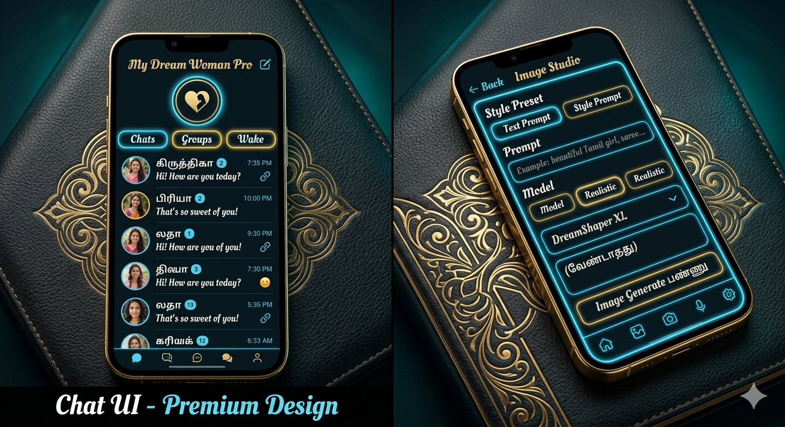
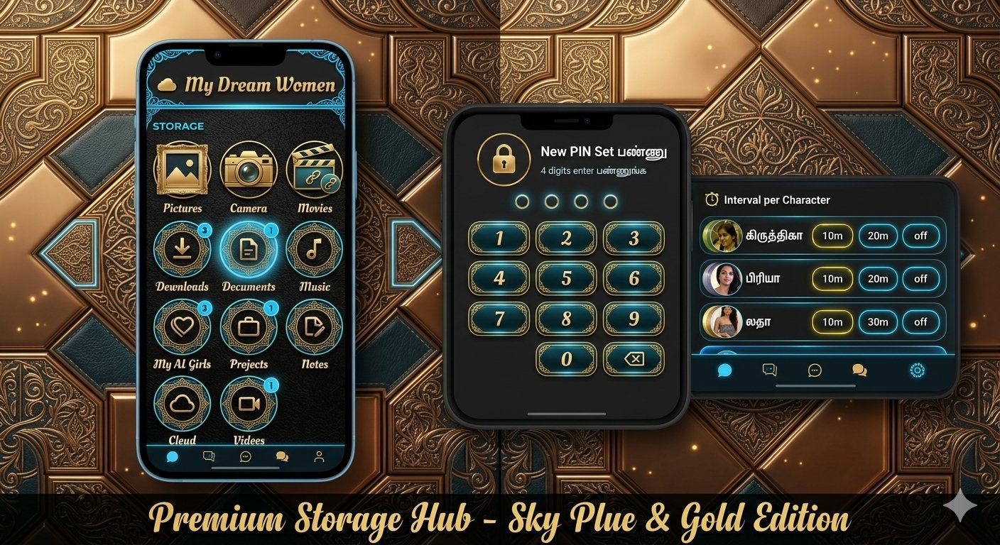

# Future handoffs

இந்த directory, ஏற்கெனவே உள்ள My Dream Woman Pro GitHub app-ஐத் தொடர்ந்து பராமரிக்க அடுத்த agent பயன்படும் உறுதிப்படுத்தப்பட்ட handoff தகவல்களுக்கானது. புதிய app உருவாக்க வேண்டாம்.

## தற்போதைய நிலை
- Step 1 read-only audit: **முடிந்தது** — [step-1-audit.md](step-1-audit.md).
- Step 2 shared design-token foundation: **முடிந்தது** — [step-2-design-system.md](step-2-design-system.md).
- Step 2 visual design board and icon concept exports: **முடிந்தது** — [design guide](../docs/design-system/README.md), [UI implementation guide](../docs/AGENTS.md), and [updated Step 2 handoff](step-2-design-system.md) (handoff update commit `adafeb66f752`). The icon exports remain design-only and are not wired into app assets.
- Steps 2–6 branch: `feature/black-leather-royal-gold` (இன்னும் `main`-க்கு merge செய்யப்படவில்லை). Step 2 token code commit `3e69dd3855e1576e7a5bdbfab1f1bd53f458af41`; Step 2 handoff/docs commit `f94c6cf6f0dea6d96a3aabe63f253551445e5ed6`.
- Step 3 Settings modal, `/settings`, `/keys` UI redesign: **code முடிந்தது** — [step-3-settings.md](step-3-settings.md); code commit `1b80712041b1be007147dfaedec83d045dd95f96`.
- Step 3 app typecheck மற்றும் live UI preview: **சரிபார்க்க முடியவில்லை** — worktree-ல் `node_modules` இல்லை; Expo workflow `expo` executable இல்லாததால் தொடங்கவில்லை. Dependency/lockfile பிரச்சினைகளை மாற்றவில்லை.
- Step 4a Chat message/send/history: **முடிந்தது** — [step-4a-chat-messages-history.md](step-4a-chat-messages-history.md); code commit `e7d25367a9dfe98e64cb7094f2dda06f85855e2f` (feature branch மட்டும்).
- Step 4a TypeScript TSX syntax parse மற்றும் diff whitespace check: **வெற்றி**; முழு app typecheck/device runtime: **சரிபார்க்க முடியவில்லை** — இந்த workspace-ல் app checkout மற்றும் Expo dependencies இல்லை.
- Step 4b Character list, character edit/save, URL மற்றும் navigation UI: **code முடிந்தது** — [step-4b-character-management.md](step-4b-character-management.md). Typecheck/live preview முடியவில்லை; காரணமும் verification வரம்பும் handoff-ல் பதிவு செய்யப்பட்டுள்ளது.
- Step 5 Cloudinary, Gallery, Image-to-Script UI restyle: **code முடிந்தது** — [step-5-cloudinary-gallery-image-to-script.md](step-5-cloudinary-gallery-image-to-script.md); code commit `80be37c30bf8ecd4730e7334bc0d6fd95d187028`.
- Step 5 TSX syntax, shared-color mapping/helper checks மற்றும் diff whitespace check: **வெற்றி**; full app typecheck மற்றும் live device preview: **சரிபார்க்க முடியவில்லை** — app dependencies/Expo types இந்த workspace-ல் இல்லை.
- Step 6 Script-to-Image + Face Swap UI restyle: **code முடிந்தது** — [step-6-script-to-image-and-swap.md](step-6-script-to-image-and-swap.md); code commit `78642ac1df1c635945d16cf7aa1ba77c21937edc`.
- Step 6 TSX syntax மற்றும் diff whitespace checks: **வெற்றி**; full app typecheck மற்றும் live preview: **சரிபார்க்க முடியவில்லை** — Expo dependencies/workflow கிடைக்கவில்லை.
- Step 7 regression validation: **நிலுவை** — Step 1 diff/path மற்றும் chat behavior read-only checks செய்யப்பட்டன; மீதமுள்ள ஆபத்துகள் [Remaining Risks](remaining-risks.md)-ல் உள்ளன.
- ஆய்வு செய்த app source commit: `7a1fadc0a928b6975edecd1e8d646c67382ce0fb`.
- Step 1 handoff commit-ல் `future/` ஆவணங்கள் மட்டும் சேர்க்கப்பட்டன; அப்போது app source/assets மாற்றப்படவில்லை.
- Step 1-க்கு GitHub Action trigger செய்யப்படவில்லை.

## கட்டாய guardrails
- `/welcome` மற்றும் `artifacts/tamil-ai-chat/app/home.tsx` மாற்றக்கூடாது.
- ஏற்கெனவே உள்ள செயல்பாடுகள், integrations, handlers, API payloads, storage, notifications மற்றும் media flows-ஐ பாதுகாக்கவும்.
- ஒவ்வொரு code phase-க்கும் முன் user-ன் வெளிப்படையான OK பெற வேண்டும்; OK வரும் வரை code மாற்றக்கூடாது.
- User நேரடியாகக் கூறிய issue/error-ஐ மட்டுமே target ஆக எடுத்துக்கொள்ளவும். Screenshot-கள் துணை ஆதாரங்கள் மட்டுமே; அவற்றிலிருந்து user சொல்லாத error-ஐ ஊகிக்கவோ, screenshot-ஐ user-ன் விளக்கத்தை விட மேலானதாகக் கருதவோ கூடாது. Error அல்லது CI failure-ஐ ஊகிக்காமல், user சுட்டிக்காட்டிய issue-க்கு தொடர்புடைய எல்லா failure path-களையும் parallel-ஆ விசாரித்து verified காரணங்களையும் proposed fix-ஐயும் report செய்து, OK வரும் வரை காத்திருக்கவும்.
- திட்டமிட்ட app-code phases-ன் மாற்றங்களை ஒரே feature branch-ல் வைத்திருக்கவும். இடைப்பட்ட phase/push-களுக்கு APK build செய்யக்கூடாது. அனைத்து phases-ம் முடிந்து approval கிடைத்த பிறகு branch-ஐ `main`-க்கு merge செய்து, `main`-ல் இருந்து ஒரே `Build APK` workflow-ஐ கைமுறையாக trigger செய்யவும்.
- Visual direction: Black Leather + Royal Gold + Sky Blue/Cyan Neon + subtle premium glassmorphism; deep charcoal backgrounds (#080B0D), gold for premium emphasis, cyan for interactive states, warm-white text, and readable Tamil copy.
- `Build APK` workflow கைமுறையாக trigger செய்யப்படும்; அது APK-ஐ GitHub Release-ல் வெளியிடும். அதே tag-ஐ rerun செய்தால் அந்த release/tag-ஐ delete செய்து மீண்டும் உருவாக்கும்; Render redeploy இயல்பாக false. Trigger-க்கு முன் இந்த side effects-ஐ user-க்கு தெளிவுபடுத்தவும்.

## Requested design brief — Black Leather + Royal Gold (Steps 2, 3, 4a, 4b, 5, 6 complete; Step 7 pending)

புதிய இணைக்கப்பட்ட file-ன் விவரக்குறிப்பு, முந்தைய Black + Electric Purple brief-ஐ முழுமையாக மாற்றுகிறது. Step 2 shared theme-token foundation, Step 3 Settings UI, Step 4a Chat message/send/history behavior, Step 4b Character list/edit/URL UI, Step 5 Cloudinary/Gallery/Image-to-Script UI, மற்றும் Step 6 Script-to-Image/Face Swap UI feature/black-leather-royal-gold branch-ல் உள்ளன. Step 7 regression validation நிலுவையில் உள்ளது.

### Reference Images

### Premium Theme Token Reference — Steps 3–7

இந்த reference, அடுத்த UI படிகளில் பயன்படுத்த வேண்டிய தற்போதைய tokens-ஐ பட்டியலிடுகிறது. Canonical source: `artifacts/tamil-ai-chat/constants/colors.ts`; app screens-ல் `useColors()` மூலம் அணுகவும். புதிய hard-coded color values சேர்க்காமல், கீழே உள்ள semantic token-ஐத் தேர்ந்தெடுக்கவும். ஏதேனும் token மாறினால் source code மற்றும் இந்த reference இரண்டையும் ஒரே branch-ல் புதுப்பிக்கவும்.

#### Surfaces and cards

| Token | பயன்பாடு | Value |
| --- | --- | --- |
| `bgPrimary` | Main app background | `#080B0D` |
| `bgSecondary` | Secondary section background | `#0C1215` |
| `bgTertiary` | Tertiary surface | `#111A1E` |
| `bgElevated` | Elevated panel | `#162126` |
| `bgDeep` | Deep background | `#050708` |
| `leatherBlack` | Leather-black surface | `#101416` |
| `leatherCharcoal` | Charcoal leather surface | `#1A2022` |
| `panelDark` | Dark panel | `#0D171B` |
| `card` | Standard card | `#11191C` |
| `cardSecondary` | Secondary card | `#172226` |
| `cardElevated` | Elevated card | `#1B292E` |

#### Royal gold

| Token | பயன்பாடு | Value |
| --- | --- | --- |
| `goldPrimary` | Premium emphasis, primary action | `#D4AF6A` |
| `goldBright` | Bright/selected gold | `#F4D58D` |
| `goldLight` | Light metallic highlight | `#FFE8B0` |
| `goldDark` | Dark gold shade | `#9B773A` |
| `goldDeep` | Deep gold shade | `#705327` |
| `goldBorder` | Premium border | `#B89555` |
| `goldMuted` | Muted gold detail | `#8D774E` |
| `goldGlow` | Gold glow tint | `rgba(212, 175, 106, 0.24)` |

#### Sky blue and cyan

| Token | பயன்பாடு | Value |
| --- | --- | --- |
| `cyanPrimary` | Active interactions and controls | `#55DDF5` |
| `cyanBright` | Bright/focused cyan | `#80EEFF` |
| `cyanLight` | Light cyan highlight | `#B6F5FF` |
| `cyanDark` | Dark cyan shade | `#168FA8` |
| `skyBlue` | Secondary blue highlight | `#63BFF2` |
| `cyanBorder` | Active border | `#278EA3` |
| `cyanGlow` | Cyan glow tint | `rgba(85, 221, 245, 0.24)` |
| `cyanSoft` | Soft cyan surface | `rgba(85, 221, 245, 0.10)` |

#### Typography colors

| Token | பயன்பாடு | Value |
| --- | --- | --- |
| `textPrimary` | Main text | `#F5F1E8` |
| `textSecondary` | Secondary text | `#C8D0D1` |
| `textTertiary` | Supporting text | `#96A5A8` |
| `textMuted` | Muted text | `#718084` |
| `textDisabled` | Disabled text | `#505B5E` |
| `textGold` | Gold-highlighted text | `#F4D58D` |
| `textCyan` | Cyan-highlighted text | `#80EEFF` |
| `textOnGold` | Text on gold controls | `#15120B` |
| `textOnCyan` | Text on cyan controls | `#061014` |

#### Borders and glass

| Token | பயன்பாடு | Value |
| --- | --- | --- |
| `border` | Standard border | `#29373B` |
| `borderSubtle` | Subtle divider/border | `#1C292D` |
| `borderGold` | Premium border | `#B89555` |
| `borderCyan` | Active border | `#278EA3` |
| `glassBackground` | Glass panel fill | `rgba(17, 26, 30, 0.88)` |
| `glassGoldBorder` | Glass panel premium edge | `rgba(212, 175, 106, 0.42)` |
| `glassCyanBorder` | Glass panel interactive edge | `rgba(85, 221, 245, 0.32)` |
| `overlay` | Modal/scrim overlay | `rgba(0, 0, 0, 0.76)` |

#### Buttons

| Token | பயன்பாடு | Value |
| --- | --- | --- |
| `buttonGold` | Premium/confirmation button | `#D4AF6A` |
| `buttonGoldHover` | Gold button highlighted state | `#F4D58D` |
| `buttonGoldPressed` | Gold button pressed state | `#B89555` |
| `buttonGoldText` | Text on gold button | `#15120B` |
| `buttonCyan` | Interactive tool/action button | `#55DDF5` |
| `buttonCyanHover` | Cyan button highlighted state | `#80EEFF` |
| `buttonCyanPressed` | Cyan button pressed state | `#168FA8` |
| `buttonCyanText` | Text on cyan button | `#061014` |
| `buttonSecondary` | Secondary button | `#172226` |
| `buttonSecondaryHover` | Secondary button highlighted state | `#223237` |
| `buttonSecondaryText` | Text on secondary button | `#F5F1E8` |
| `buttonDisabled` | Disabled button | `#293034` |

#### Inputs and forms

| Token | பயன்பாடு | Value |
| --- | --- | --- |
| `inputBackground` | Input fill | `#0B1215` |
| `inputBorder` | Default input border | `#35464B` |
| `inputFocus` | Focused input border | `#55DDF5` |
| `inputText` | Input value | `#F5F1E8` |
| `inputPlaceholder` | Placeholder text | `#829196` |
| `inputLabel` | Field label | `#C8D0D1` |

#### Chat and status

| Token | பயன்பாடு | Value |
| --- | --- | --- |
| `chatBackground` | Chat surface | `#080D10` |
| `chatUserBubble` | User message bubble | `#153D46` |
| `chatUserText` | User message text | `#F5FCFF` |
| `chatAiBubble` | AI message bubble | `#172126` |
| `chatAiText` | AI message text | `#F5F1E8` |
| `chatDivider` | Chat divider | `#29373B` |
| `chatTimestamp` | Message timestamp | `#96A5A8` |
| `chatOnline` | Online/active indicator | `#55DDF5` |
| `success` | Success message/state | `#55D6A0` |
| `warning` | Warning message/state | `#F2C66D` |
| `error` | Error message/state | `#FF7D86` |
| `info` | Informational message/state | `#63BFF2` |

#### Layout and typography scale

| Token | Value | பயன்பாடு |
| --- | --- | --- |
| `radius` | `10` | Existing shared corner radius |
| `spacing.space1` / `space2` / `space3` | `4` / `8` / `12` | Tight spacing |
| `spacing.space4` / `space5` | `16` / `20` | Standard content spacing |
| `spacing.space6` / `space8` | `24` / `32` | Section spacing |
| `typography.fontSize.pageTitle` | `26` | Page title |
| `typography.fontSize.sectionHeading` | `20` | Section heading |
| `typography.fontSize.cardTitle` | `17` | Card title |
| `typography.fontSize.body` | `15` | Body copy |
| `typography.fontSize.supporting` | `13` | Supporting copy |
| `typography.fontSize.button` | `15` | Button label |
| `typography.fontSize.metadata` | `12` | Metadata |
| `typography.fontWeight` | `400`, `500`, `600`, `700` | Regular, medium, semibold, bold |
| `typography.lineHeight` | `36`, `28`, `24`, `22`, `19`, `21`, `17` | Page title, section, card, body, supporting, button, metadata order |
| `typography.fontFamily` | `regular`: `Inter_400Regular`; `medium`: `Inter_500Medium`; `semibold`: `Inter_600SemiBold`; `bold`: `Inter_700Bold`; `decorativeSerif`: `serif`; `mono`: `monospace` | Use loaded Inter weights; let Tamil use platform fallback where needed |

#### Gradients and glow effects

| Token | Value |
| --- | --- |
| `gradients.royalGold` | `#8D6A32 → #D4AF6A → #FFE8B0 → #B89555` |
| `gradients.skyBlueNeon` | `#168FA8 → #55DDF5 → #B6F5FF` |
| `gradients.premiumDarkGlass` | `rgba(28, 41, 46, 0.96) → rgba(8, 11, 13, 0.96)` |
| `effects.goldGlow` | Shadow `#D4AF6A`, opacity `0.18`, radius `12`, offset `(0, 0)`, elevation `3` |
| `effects.cyanGlow` | Shadow `#55DDF5`, opacity `0.20`, radius `14`, offset `(0, 0)`, elevation `4` |

#### Existing `useColors()` compatibility aliases

புதிய screen-களுக்கு மேலே உள்ள semantic tokens-ஐ முன்னுரிமையாகப் பயன்படுத்தவும். Existing screens மாறும் வரை இந்த aliases-ஐ வைத்திருக்கவும்:

| Existing key | Maps to |
| --- | --- |
| `background` / `foreground` | `bgPrimary` / `textPrimary` |
| `primary` / `primaryForeground` | `goldPrimary` / `textOnGold` |
| `secondary` / `secondaryForeground` | `buttonSecondary` / `buttonSecondaryText` |
| `accent` / `accentForeground` / `tint` | `cyanPrimary` / `textOnCyan` / `cyanPrimary` |
| `muted` / `mutedForeground` | `leatherCharcoal` / `textTertiary` |
| `text` / `cardForeground` | `textPrimary` / `textPrimary` |
| `destructive` / `destructiveForeground` | `error` / `textPrimary` |
| `input` | `inputBorder` |

`light` மற்றும் `dark` system schemes இரண்டும் ஒரே fixed dark luxury palette-ஐப் பயன்படுத்துகின்றன. Gold-ஐ premium emphasis/confirmation-க்கு, cyan-ஐ interaction/focus/active states-க்கு பயன்படுத்தவும்; ஒவ்வொரு screen-லும் Tamil text readable ஆக இருப்பதைச் சரிபார்க்கவும்.

COMPLETE PREMIUM UI/UX REDESIGN

Black Leather + Royal Gold + Sky Blue Neon + Premium Glassmorphism

DESIGN VISION

Redesign the existing app into a futuristic luxury AI application inspired by the supplied reference images.

Combine:

- Black leather luxury aesthetics
- Royal gold metallic accents
- Sky blue / cyan neon highlights
- Premium glassmorphism
- Elegant typography
- Consistent text alignment
- Professional layouts and spacing
- Refined buttons, icons, cards, borders, and input fields

The result should feel like a premium luxury AI product, not a typical gaming interface.

IMPORTANT: Preserve existing functionality, APIs, backend logic, navigation, stored preferences, and workflows.

---

1. COMPLETE PREMIUM COLOUR PALETTE

Use the following colour system consistently across all targeted screens.

A. Background Colours

--color-bg-primary: #080B0D;
--color-bg-secondary: #0C1215;
--color-bg-tertiary: #111A1E;
--color-bg-elevated: #162126;
--color-bg-deep: #050708;

--color-leather-black: #101416;
--color-leather-charcoal: #1A2022;
--color-panel-dark: #0D171B;

Purpose:

- Main application background: "#080B0D"
- Secondary sections: "#0C1215"
- Elevated panels: "#162126"
- Premium dark surfaces: "#101416"

Use dark backgrounds as the foundation. Avoid bright backgrounds across the main interface.

B. Royal Gold Palette

--color-gold-primary: #D4AF6A;
--color-gold-bright: #F4D58D;
--color-gold-light: #FFE8B0;
--color-gold-dark: #9B773A;
--color-gold-deep: #705327;

--color-gold-border: #B89555;
--color-gold-muted: #8D774E;
--color-gold-glow: rgba(212, 175, 106, 0.24);

Use gold for:

- Premium headings and selected labels
- Luxury borders
- Selected controls
- Premium badges
- Special icons
- Important secondary actions
- Subtle decorative details

Gold must look metallic and elegant. Avoid using bright yellow as a substitute for gold.

C. Sky Blue and Cyan Neon Palette

--color-cyan-primary: #55DDF5;
--color-cyan-bright: #80EEFF;
--color-cyan-light: #B6F5FF;
--color-cyan-dark: #168FA8;
--color-sky-blue: #63BFF2;

--color-cyan-border: #278EA3;
--color-cyan-glow: rgba(85, 221, 245, 0.24);
--color-cyan-soft: rgba(85, 221, 245, 0.10);

Use cyan for:

- Active navigation icons
- Focused inputs
- Selected tabs
- Active buttons
- Chat interaction controls
- Progress indicators
- Important interactive highlights

Use cyan as an accent, not as the main background colour.

D. Typography Colours

--color-text-primary: #F5F1E8;
--color-text-secondary: #C8D0D1;
--color-text-tertiary: #96A5A8;
--color-text-muted: #718084;
--color-text-disabled: #505B5E;

--color-text-gold: #F4D58D;
--color-text-cyan: #80EEFF;
--color-text-on-gold: #15120B;
--color-text-on-cyan: #061014;

Maintain sufficient contrast between text and its background.

Do not make all text gold or cyan. Use warm white for primary text, muted grey for supporting text, gold for luxury emphasis, and cyan for interactive highlights.

E. Cards, Borders, and Glassmorphism

--color-card: #11191C;
--color-card-secondary: #172226;
--color-card-elevated: #1B292E;

--color-border: #29373B;
--color-border-subtle: #1C292D;
--color-border-gold: #B89555;
--color-border-cyan: #278EA3;

--color-glass-bg: rgba(17, 26, 30, 0.88);
--color-glass-gold-border: rgba(212, 175, 106, 0.42);
--color-glass-cyan-border: rgba(85, 221, 245, 0.32);
--color-overlay: rgba(0, 0, 0, 0.76);

Use:

- Gold borders for premium sections and selected luxury components.
- Cyan borders for interactive and focused elements.
- Neutral dark borders for ordinary cards.
- Translucent surfaces for modals and floating panels.

Keep glassmorphism subtle enough to preserve readability.

F. Buttons

--color-button-gold: #D4AF6A;
--color-button-gold-hover: #F4D58D;
--color-button-gold-pressed: #B89555;
--color-button-gold-text: #15120B;

--color-button-cyan: #55DDF5;
--color-button-cyan-hover: #80EEFF;
--color-button-cyan-pressed: #168FA8;
--color-button-cyan-text: #061014;

--color-button-secondary: #172226;
--color-button-secondary-hover: #223237;
--color-button-secondary-text: #F5F1E8;

--color-button-disabled: #293034;

Primary actions should use gold or cyan according to their role.

Use gold for premium or primary confirmation actions and cyan for active interactive tools. Avoid giving every button a different colour.

G. Inputs, Forms, and Search

--color-input-bg: #0B1215;
--color-input-border: #35464B;
--color-input-focus: #55DDF5;
--color-input-text: #F5F1E8;
--color-input-placeholder: #829196;
--color-input-label: #C8D0D1;

Provide clear focus indicators and readable placeholder text.

H. Chat Colours

--color-chat-bg: #080D10;
--color-chat-user-bubble: #153D46;
--color-chat-user-text: #F5FCFF;
--color-chat-ai-bubble: #172126;
--color-chat-ai-text: #F5F1E8;
--color-chat-divider: #29373B;
--color-chat-timestamp: #96A5A8;
--color-chat-online: #55DDF5;

Use dark, refined message bubbles with subtle cyan or gold accents.

I. Status Colours

--color-success: #55D6A0;
--color-warning: #F2C66D;
--color-error: #FF7D86;
--color-info: #63BFF2;

Preserve clear visual distinctions between success, warning, error, and informational states.

---

2. PREMIUM GRADIENTS AND LIGHT EFFECTS

Use gradients sparingly.

Royal Gold Gradient

linear-gradient(
  135deg,
  #8D6A32 0%,
  #D4AF6A 45%,
  #FFE8B0 70%,
  #B89555 100%
)

Sky Blue Neon Gradient

linear-gradient(
  135deg,
  #168FA8 0%,
  #55DDF5 55%,
  #B6F5FF 100%
)

Premium Dark Glass Gradient

linear-gradient(
  145deg,
  rgba(28, 41, 46, 0.96),
  rgba(8, 11, 13, 0.96)
)

Gold Glow

0 0 12px rgba(212, 175, 106, 0.18)

Cyan Glow

0 0 14px rgba(85, 221, 245, 0.20)

Do not apply strong glows to every component. Use them for active controls, focused inputs, selected cards, and important actions only.

---

3. TYPOGRAPHY REDESIGN

Create a consistent typography hierarchy across the application.

Font Families

- Primary UI font: use the existing readable sans-serif font or a compatible modern font such as Inter.
- Tamil text: use a font with reliable Tamil glyph coverage, such as Noto Sans Tamil, where supported.
- Decorative luxury typography: reserve elegant serif typography for selected branding or decorative headings only.

Do not use decorative fonts for every label, input, button, or paragraph.

Recommended Typography Scale

Element| Size| Weight
Main page title| 24–28 px| 700
Section heading| 18–22 px| 600
Card title| 16–18 px| 600
Body text| 14–16 px| 400
Supporting text| 12–14 px| 400
Button label| 14–16 px| 600
Small metadata| 11–12 px| 500

Use these as design targets and adapt them to the existing mobile framework and screen density.

Typography Rules

- Use consistent font weights.
- Maintain comfortable line heights.
- Avoid excessive letter spacing.
- Prevent clipped Tamil characters and mixed Tamil-English text.
- Keep buttons and input labels readable.
- Use gold for selected titles, not for all body text.
- Maintain consistent text hierarchy on every screen.

---

4. TEXT ALIGNMENT REDESIGN

Correct text alignment throughout all targeted UI components.

Page Titles

- Use consistent left alignment.
- Align titles with the main content edge.
- Keep back buttons and action icons vertically centered.

Forms

- Left-align labels, input fields, descriptions, and validation messages.
- Keep labels directly associated with their inputs.
- Align form controls consistently.

Buttons

- Center button labels vertically and horizontally where appropriate.
- Align icons and text consistently.
- Prevent icons from shifting when button labels change.

Cards

- Use consistent title and description alignment.
- Keep action buttons in predictable positions.
- Maintain uniform spacing between card elements.

Chat

- Preserve the established conversational alignment.
- Align timestamps, avatars, message bubbles, and input controls consistently.
- Prevent long messages from overflowing the viewport.

Settings

- Align icons, titles, subtitles, switches, and dropdown indicators.
- Keep each setting row visually balanced.

Do not center every element. Choose alignment based on content type and usability.

---

5. LAYOUT, SPACING, AND COMPONENT STYLES

Use a consistent spacing system:

--space-1: 4px;
--space-2: 8px;
--space-3: 12px;
--space-4: 16px;
--space-5: 20px;
--space-6: 24px;
--space-8: 32px;

Recommended component styling:

- Cards: consistent internal padding and border treatment.
- Inputs: consistent heights, padding, and focus states.
- Buttons: consistent heights, touch targets, and icon spacing.
- Settings rows: consistent vertical alignment and separators.
- Modals: clear hierarchy, appropriate margins, and readable actions.
- Navigation: consistent icon sizes and active-state indicators.

Respect existing platform conventions and component dimensions when necessary.

---

6. SCREEN-BY-SCREEN REDESIGN

A. Chat Screen

- Deep charcoal background.
- Refined dark message bubbles.
- Cyan active controls.
- Gold accents for premium highlights.
- Readable timestamps and message text.
- Polished message composer and action icons.

B. Character List

- Consistent portrait sizing and aspect ratios.
- Dark premium cards.
- Gold borders for selected premium states.
- Cyan selection indicators.
- Clear character names and descriptions.

C. Character Edit

- Consistent form layout.
- Refined input fields.
- Premium upload and preview cards.
- Clear save, cancel, and other existing actions.
- Consistent focus, disabled, success, and error states.

D. Settings and Nested Options

- Consistent settings sections.
- Dark surfaces with subtle borders.
- Cyan focus and active indicators.
- Gold highlights for premium options.
- Consistent switches, dropdowns, labels, and descriptions.

E. Storage Hub

- Premium dark storage cards.
- Gold or cyan outlined icons.
- Consistent image, camera, movie, document, music, cloud, and other existing category styles.
- Clear labels and notification badges.
- Preserve all existing storage actions.

F. PIN and Security Screens

- Clear PIN indicators.
- Consistent keypad buttons.
- Gold accents for security-related branding.
- Cyan focus and interaction feedback.
- Maintain readable instructions and status messages.

G. Character Interval Controls

- Consistent character rows.
- Clearly distinguish selected intervals.
- Use cyan for active selection and gold for premium emphasis.
- Preserve the existing interval options and saved values.

H. Cloudinary / Image Cloud

- Dark workspace panels.
- Consistent upload and preview areas.
- Cyan interactive borders.
- Gold primary action accents where appropriate.
- Preserve upload, processing, and existing image workflows.

I. Image to Script

- Consistent prompt inputs.
- Refined selection controls.
- Clear labels and action hierarchy.
- Readable results and status indicators.
- Preserve existing generation functionality.

J. Script to Image

- Premium dark prompt editor.
- Consistent model and style selectors.
- Clearly visible generation action.
- Refined image preview layout.
- Preserve existing model choices and generation behavior.

K. Swap

- Consistent upload cards and preview sections.
- Clear primary and secondary actions.
- Refined loading and result states.
- Preserve all existing swap functionality.

---

7. ICONS AND INTERACTION STATES

Use one consistent icon style throughout the app.

- Normal icons: muted silver-grey.
- Active icons: sky blue/cyan.
- Premium accents: royal gold.
- Disabled icons: subdued grey.
- Focused controls: visible cyan outline.
- Selected premium components: subtle gold outline.

Do not mix unrelated icon styles or use emoji as a substitute for existing interface icons.

Preserve existing icon meanings and click actions.

---

8. RESPONSIVE DESIGN

- Prioritize mobile layouts.
- Support existing tablet and desktop layouts.
- Prevent horizontal overflow.
- Avoid clipped text and overlapping controls.
- Respect device safe areas.
- Ensure forms remain usable with the keyboard open.
- Keep buttons and touch targets comfortably usable.
- Maintain image proportions across screen sizes.

---

9. IMPLEMENTATION REQUIREMENTS

Before making changes:

1. Inspect the existing codebase and theme-token architecture.
2. Identify all targeted non-Home UI files.
3. Reuse the existing shared theme-token file if available.
4. Do not create duplicate theme systems.
5. Map the palette to semantic tokens.
6. Replace hardcoded colours carefully.
7. Preserve dynamic colours, status indicators, and user-selected preferences.
8. Check both StyleSheet colours and inline icon/button colours.
9. Make changes in small, verifiable steps.

Strictly Preserve

- Home and Welcome screens.
- Route definitions and redirects.
- APIs and request/response formats.
- Backend logic.
- Existing features and navigation.
- State management and saved user choices.
- GitHub Actions workflows.
- APK build and GitHub Release configuration.
- Render deployment configuration.

Do not replace real functionality with mock data or remove existing options.

---

10. VALIDATION AND FINAL REPORT

After implementation:

- Run available local checks.
- Verify imports and theme-token references.
- Run available tests and the production build.
- Inspect all modified screens.
- Check typography, alignment, contrast, clipping, and responsive behavior.
- Verify that existing features and navigation remain intact.
- Report the changed files, checks performed, build results, and unresolved issues.

Do not claim successful validation unless the relevant checks were actually executed.

---

FINAL DESIGN GOAL

Create a unified luxury AI application inspired by the supplied references:

BLACK LEATHER + ROYAL GOLD + SKY BLUE NEON + PREMIUM GLASSMORPHISM.

The app should feel elegant, futuristic, polished, readable, and consistent across every targeted screen.

Prioritize usability, premium visual hierarchy, accurate text alignment, and preservation of existing functionality over excessive decoration.

## கட்டம்-வாரியான handoff பதிவு

- ஒவ்வொரு step முடிந்ததும், `future/step-N-<சுருக்கப்பெயர்>.md` என்ற file-ல் முடிந்த scope, மாற்றிய files, verification/build முடிவு, commit SHA, blockers, அடுத்த step மற்றும் pending approval-களை பதிவு செய்யவும். Step 1-க்கு உள்ள `step-1-audit.md` பெயரிடும் முறையைப் பின்பற்றவும்.
- `future/README.md`-ல் தற்போதைய status, முடிந்த step, அடுத்த step, அந்த step-க்கு தேவையான approval, தொடர்புடைய handoff file link ஆகியவற்றைப் புதுப்பிக்கவும். Verified evidence மட்டுமே குறிப்பிடவும்; secrets சேர்க்க வேண்டாம்.
- Handoff docs-ஐ GitHub-க்கு normal commit/push ஆகச் சேர்க்கவும்; இது `Build APK` workflow-ஐ trigger செய்யும் முறை அல்ல. Docs-only update-க்கு APK build தேவையில்லை.
- Code changes-ஐ ஒரே feature branch-ல் commit/push செய்யவும். திட்டமிட்ட app-code phases அனைத்தும் முடிந்து approval கிடைத்த பிறகே அந்த branch-ஐ `main`-க்கு merge செய்யவும்; பின்னர் `main`-இலிருந்து `Build APK`-ஐ ஒரே முறை கைமுறையாக trigger செய்யவும். இடைப்பட்ட build-கள் செய்ய வேண்டாம்.
- Build trigger-க்கு முன் Release side effect-ஐ தெரிவிக்கவும்: workflow APK-ஐ GitHub Release-ல் வெளியிடும்; அதே tag-ஐ rerun செய்தால் ஏற்கெனவே உள்ள release/tag-ஐ delete செய்து மீண்டும் உருவாக்கும். Render redeploy input இயல்பாக false.

## அடுத்த நிலை
Step 6 Script-to-Image + Face Swap UI restyle முடிந்தது — [step-6-script-to-image-and-swap.md](step-6-script-to-image-and-swap.md)-ல் scope, பாதுகாக்கப்பட்ட flows, commit மற்றும் verification வரம்புகள் உள்ளன. Step 7 regression validation இன்னும் முழுமையடையவில்லை; அதன் Step 1 diff/path மற்றும் chat behavior read-only checks செய்யப்பட்டுள்ளன. மீதமுள்ள ஆபத்துகள் [Remaining Risks](remaining-risks.md)-ல் உள்ளன. கட்டப் பரிந்துரை மற்றும் உறுதிப்படுத்தப்பட்ட route/handler map `step-1-audit.md`-ல் உள்ளது.
